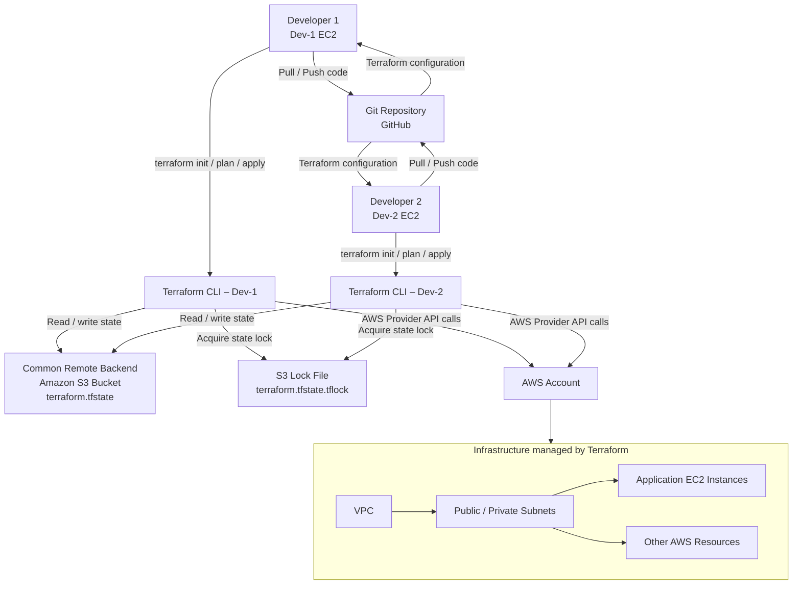

# Terraform AWS Infrastructure – Shared Remote State Architecture

## Project Overview

This project demonstrates how two developers or two EC2-based development environments can work with the same Terraform project while sharing one remote Terraform state file.

**Main idea:** GitHub stores the Terraform code. Amazon S3 stores the common Terraform state file. Both development environments use the same S3 backend so Terraform can track the infrastructure consistently.

## One Combined Architecture



## How the Architecture Works

1. **GitHub:** Stores the Terraform files and source-code history.
2. **Dev-1 EC2:** Developer 1 gets the code from GitHub and runs Terraform commands.
3. **Dev-2 EC2:** Developer 2 gets the same code from GitHub and runs Terraform commands.
4. **Common S3 bucket:** Both Terraform environments use the same remote state object, for example `dev/terraform.tfstate`.
5. **State locking:** Terraform uses an S3 lock file to prevent two operations from modifying the same state at the same time.
6. **AWS infrastructure:** Terraform uses the AWS provider and the shared state to create and manage resources such as VPCs, subnets, and EC2 instances.

> The S3 bucket is remote state storage. It is not a VPC subnet and does not need to be placed inside the VPC. Terraform accesses S3 through AWS APIs and IAM permissions.

## Local State vs Remote State

| Local state | Remote S3 state |
|---|---|
| Stored on one machine | Stored in a shared S3 bucket |
| Difficult to share safely between developers | Can be accessed by authorized developers |
| Can become inconsistent when copies are used | Provides one shared state location |
| Not recommended for this shared workflow | Recommended for this shared workflow |

## Terraform S3 Backend Configuration

Create `backend.tf` in the Terraform root module:

```hcl
terraform {
  backend "s3" {
    bucket       = "your-unique-terraform-state-bucket"
    key          = "dev/terraform.tfstate"
    region       = "ap-south-1"
    encrypt      = true
    use_lockfile = true
  }
}
```

Replace the bucket name and region with your actual S3 bucket details.

**Requirements:**

- Create the S3 bucket before initializing the backend.
- Enable S3 bucket versioning to help recover earlier state versions.
- Give both Dev-1 and Dev-2 the required IAM permissions to access the bucket and state object.
- Allow the required permissions to create, read, and delete the S3 lock object.
- `use_lockfile = true` requires Terraform 1.10 or later.
- Do not commit AWS credentials, Terraform state files, or secret variable files to GitHub.

### Enable S3 Bucket Versioning

Run this once after creating the bucket:

```bash
aws s3api put-bucket-versioning \
  --bucket your-unique-terraform-state-bucket \
  --versioning-configuration Status=Enabled
```

## Steps to Use the Shared Backend

Run these commands from the Terraform project directory on both Dev-1 and Dev-2:

```bash
git clone <your-github-repository-url>
cd <your-terraform-project>
terraform init
terraform fmt
terraform validate
terraform plan
```

Only run `terraform apply` when the plan has been reviewed and the developer is authorized to make the change:

```bash
terraform apply
```

If the project already has a local state file that must be moved to S3, use this command during the migration:

```bash
terraform init -migrate-state
```

Review Terraform's migration prompt before confirming. Do not independently create separate local state files for the same shared infrastructure.

## Git Workflow

```bash
git status
git add .
git commit -m "Configure Terraform S3 remote backend"
git push origin main
```

## Suggested `.gitignore`

```gitignore
.terraform/
*.tfstate
*.tfstate.*
*.tfvars
*.tfplan
crash.log
```

## Important Points

- **GitHub = Terraform code**
- **Amazon S3 = Common Terraform state file**
- **S3 lock file = Prevents concurrent state operations**
- **Dev-1 and Dev-2 = Separate environments running Terraform**
- **AWS provider = Creates and manages AWS resources**
- Do not run simultaneous Terraform applies against the same state. The lock file helps serialize state operations; it does not replace code review or team coordination.

## Summary

Both Dev-1 and Dev-2 download the same Terraform code from GitHub. Both connect to the same S3 remote backend. The common state file helps both environments work from the same record of managed infrastructure, while state locking helps prevent conflicting concurrent operations.
